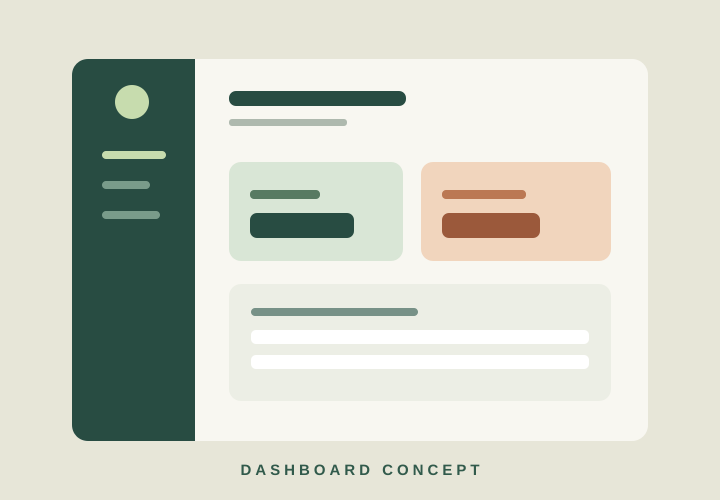
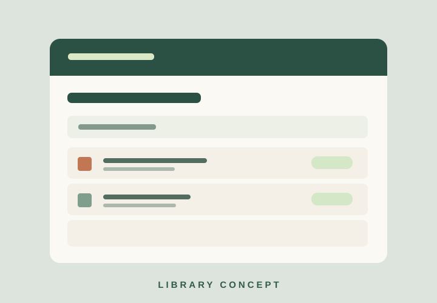

# Cassandra Maxine J. Eran ? complete source files

Each text file appears in full below, with its path above its code block. The original binary portrait is included separately at `assets/profile.jpg`.

## `/index.html`

```html
<!doctype html>
<html lang="en">
  <head>
    <meta charset="utf-8">
    <meta name="viewport" content="width=device-width, initial-scale=1">
    <meta name="description" content="Portfolio and CV of Cassandra Maxine J. Eran, a college student and aspiring web developer.">
    <meta name="theme-color" content="#f7f5f0">
    <title>Cassandra Maxine J. Eran | Portfolio & CV</title>
    <link rel="preconnect" href="https://fonts.googleapis.com">
    <link rel="preconnect" href="https://fonts.gstatic.com" crossorigin>
    <link href="https://fonts.googleapis.com/css2?family=DM+Sans:wght@400;500;600;700&family=Manrope:wght@400;500;600;700;800&display=swap" rel="stylesheet">
    <link rel="stylesheet" href="css/styles.css">
    <script src="js/main.js" defer>
    </script>
  </head>
  <body>
    <div class="page-loader" id="page-loader" aria-hidden="true">
      <span class="page-loader__mark">CE<span>.</span>
      </span>
    </div>
    <div class="scroll-progress" id="scroll-progress" aria-hidden="true">
    </div>
    <a class="skip-link" href="#main">Skip to content</a>
    <!-- Header and primary navigation -->
    <header class="site-header" id="top">
      <nav class="nav container" aria-label="Main navigation">
        <a class="nav__brand" href="#top" aria-label="Cassandra Maxine J. Eran, back to top">CE<span>.</span>
        </a>
        <button class="nav__menu-toggle" type="button" aria-label="Open menu" aria-expanded="false" aria-controls="nav-links">
          <span>
          </span>
          <span>
          </span>
          <span>
          </span>
        </button>
        <div class="nav__links" id="nav-links">
          <a class="nav__link is-active" href="#about">About</a>
          <a class="nav__link" href="#education">Education</a>
          <a class="nav__link" href="#skills">Skills</a>
          <a class="nav__link" href="#projects">Projects</a>
          <a class="nav__link" href="#experience">Experience</a>
          <a class="nav__link" href="#contact">Contact</a>
        </div>
        <button class="theme-toggle" id="theme-toggle" type="button" aria-label="Switch to dark mode" title="Toggle color theme">
          <span class="theme-toggle__icon" aria-hidden="true">☾</span>
        </button>
      </nav>
    </header>
    <main id="main">
      <!-- Personal profile -->
      <section class="hero section" id="about" aria-labelledby="hero-title">
        <div class="container hero__grid">
          <div class="hero__content reveal">
            <p class="eyebrow">
              <span class="eyebrow__line">
              </span> HELLO, I'M CASSANDRA</p>
            <h1 class="hero__title" id="hero-title">Building for the web, <em>learning for life.</em>
            </h1>
            <p class="hero__name">Cassandra Maxine J. Eran <span aria-hidden="true">✳</span>
            </p>
            <p class="hero__intro">College Student and Aspiring Web Developer</p>
            <p class="hero__description">I enjoy turning ideas into thoughtful digital experiences. I'm growing my skills in front-end development, collaboration, and practical problem solving—one project at a time.</p>
            <div class="hero__actions">
              <a class="button button--primary" href="#projects">Explore my work <span aria-hidden="true">↗</span>
              </a>
              <a class="button button--text" href="#contact">Get in touch <span aria-hidden="true">→</span>
              </a>
            </div>
            <div class="hero__meta">
              <span class="status-dot" aria-hidden="true">
              </span> Open to learning opportunities & collaboration</div>
          </div>
          <div class="hero__visual reveal">
            <div class="portrait">
              <div class="portrait__frame">
                <div class="portrait__initials" id="portrait-initials" aria-hidden="true">CE</div>
                
              </div>
              <div class="portrait__caption">
                <span>01 / INTRODUCTION</span>
                <span>ASPIRING WEB DEVELOPER</span>
              </div>
            </div>
            <div class="hero__badge" aria-hidden="true">
              <span>CREATIVE<br>THINKER</span>
              <span class="hero__badge-star">✳</span>
            </div>
          </div>
        </div>
      </section>
      <!-- Basic information and career objective -->
      <section class="section section--paper" id="profile" aria-labelledby="profile-title">
        <div class="container profile__grid">
          <div class="section-heading reveal">
            <p class="eyebrow">01 / ABOUT ME</p>
            <h2 id="profile-title">Curious by nature.<br>
              <em>Driven by purpose.</em>
            </h2>
          </div>
          <div class="profile__content reveal">
            <p class="lead">I'm a student interested in the space where design, technology, and real needs meet.</p>
            <p>My career objective is to become a web developer who creates accessible, useful, and engaging websites. I value clear communication, continuous learning, and doing good work with a team.</p>
            <dl class="info-list">
              <div>
                <dt>Location</dt>
                <dd>Prk. Tagumpay, Brgy. Gredu, Panabo City, Davao del Norte</dd>
              </div>
              <div>
                <dt>Birth date</dt>
                <dd><time datetime="2003-07-13">July 13, 2003</time> (<span id="current-age">23</span> years old)</dd>
              </div>
              <div>
                <dt>Email</dt>
                <dd><a href="mailto:YOUR_EMAIL@example.com">YOUR_EMAIL@example.com</a></dd>
              </div>
              <div>
                <dt>Phone</dt>
                <dd><a href="tel:+639913606579">09913606579</a></dd>
              </div>
              <div>
                <dt>Interests</dt>
                <dd>Web development &middot; UI design &middot; Databases</dd>
              </div>
            </dl>
          </div>
        </div>
      </section>
      <!-- Education -->
      <section class="section" id="education" aria-labelledby="education-title">
        <div class="container">
          <div class="section-heading section-heading--row reveal">
            <div>
              <p class="eyebrow">02 / MY JOURNEY</p>
              <h2 id="education-title">Education<span class="heading-dot">.</span>
              </h2>
            </div>
            <p class="section-heading__aside">A foundation built through curiosity and consistent practice.</p>
          </div>
          <div class="timeline">
            <article class="timeline__item reveal">
              <span class="timeline__number">01</span>
              <div>
                <p class="timeline__label">COLLEGE &middot; YOUR_YEAR_LEVEL</p>
                <h3>YOUR_COLLEGE_PROGRAM</h3>
                <p>Davao del Norte State College</p>
                <p class="timeline__detail">Add your degree or program and a short note about your studies.</p>
              </div>
              <span class="timeline__date">ADD YEARS</span>
            </article>
            <article class="timeline__item reveal">
              <span class="timeline__number">02</span>
              <div>
                <p class="timeline__label">SENIOR HIGH SCHOOL</p>
                <h3>YOUR_STRAND / TRACK</h3>
                <p>Panabo City Senior High School</p>
                <p class="timeline__detail">Add your strand, academic work, or a relevant school activity.</p>
              </div>
              <span class="timeline__date">ADD YEARS</span>
            </article>
            <article class="timeline__item reveal">
              <span class="timeline__number">03</span>
              <div>
                <p class="timeline__label">SECONDARY EDUCATION</p>
                <h3>North Davao Colleges</h3>
                <p class="timeline__detail">Add the years attended and any relevant recognition.</p>
              </div>
              <span class="timeline__date">ADD YEARS</span>
            </article>
            <article class="timeline__item reveal">
              <span class="timeline__number">04</span>
              <div>
                <p class="timeline__label">ELEMENTARY EDUCATION</p>
                <h3>Gredu Elementary School</h3>
              </div>
              <span class="timeline__date">ADD YEARS</span>
            </article>
            <article class="timeline__item reveal">
              <span class="timeline__number">05</span>
              <div>
                <p class="timeline__label">ACADEMIC ACHIEVEMENTS</p>
                <h3>Your achievements here</h3>
                <p class="timeline__detail">Replace this with honors, scholarships, recognition, or a relevant academic milestone.</p>
              </div>
              <span class="timeline__date">ADD YEAR</span>
            </article>
          </div>
        </div>
      </section>
      <!-- Technical and professional skills -->
      <section class="section section--ink" id="skills" aria-labelledby="skills-title">
        <div class="container">
          <div class="section-heading section-heading--row reveal">
            <div>
              <p class="eyebrow">03 / WHAT I BRING</p>
              <h2 id="skills-title">Skills & strengths<span class="heading-dot">.</span>
              </h2>
            </div>
            <p class="section-heading__aside">A growing toolkit, shaped by classwork and hands-on practice.</p>
          </div>
          <div class="skills__grid">
            <div class="skills__group reveal">
              <h3>Technical skills</h3>
              <div class="skill">
                <div class="skill__label">
                  <span>HTML</span>
                  <span>85%</span>
                </div>
                <div class="skill__track" role="progressbar" aria-label="HTML proficiency" aria-valuenow="85" aria-valuemin="0" aria-valuemax="100">
                  <span class="skill__fill" data-level="85">
                  </span>
                </div>
              </div>
              <div class="skill">
                <div class="skill__label">
                  <span>CSS</span>
                  <span>80%</span>
                </div>
                <div class="skill__track" role="progressbar" aria-label="CSS proficiency" aria-valuenow="80" aria-valuemin="0" aria-valuemax="100">
                  <span class="skill__fill" data-level="80">
                  </span>
                </div>
              </div>
              <div class="skill">
                <div class="skill__label">
                  <span>JavaScript</span>
                  <span>70%</span>
                </div>
                <div class="skill__track" role="progressbar" aria-label="JavaScript proficiency" aria-valuenow="70" aria-valuemin="0" aria-valuemax="100">
                  <span class="skill__fill" data-level="70">
                  </span>
                </div>
              </div>
              <div class="skill">
                <div class="skill__label">
                  <span>Git & GitHub</span>
                  <span>72%</span>
                </div>
                <div class="skill__track" role="progressbar" aria-label="Git and GitHub proficiency" aria-valuenow="72" aria-valuemin="0" aria-valuemax="100">
                  <span class="skill__fill" data-level="72">
                  </span>
                </div>
              </div>
              <div class="skill">
                <div class="skill__label">
                  <span>Databases</span>
                  <span>65%</span>
                </div>
                <div class="skill__track" role="progressbar" aria-label="Database proficiency" aria-valuenow="65" aria-valuemin="0" aria-valuemax="100">
                  <span class="skill__fill" data-level="65">
                  </span>
                </div>
              </div>
            </div>
            <div class="skills__group reveal">
              <h3>Professional skills</h3>
              <div class="skill">
                <div class="skill__label">
                  <span>Problem solving</span>
                  <span>82%</span>
                </div>
                <div class="skill__track" role="progressbar" aria-label="Problem solving proficiency" aria-valuenow="82" aria-valuemin="0" aria-valuemax="100">
                  <span class="skill__fill" data-level="82">
                  </span>
                </div>
              </div>
              <div class="skill">
                <div class="skill__label">
                  <span>Communication</span>
                  <span>84%</span>
                </div>
                <div class="skill__track" role="progressbar" aria-label="Communication proficiency" aria-valuenow="84" aria-valuemin="0" aria-valuemax="100">
                  <span class="skill__fill" data-level="84">
                  </span>
                </div>
              </div>
              <div class="skill">
                <div class="skill__label">
                  <span>Teamwork</span>
                  <span>88%</span>
                </div>
                <div class="skill__track" role="progressbar" aria-label="Teamwork proficiency" aria-valuenow="88" aria-valuemin="0" aria-valuemax="100">
                  <span class="skill__fill" data-level="88">
                  </span>
                </div>
              </div>
              <p class="skills__note">These levels are illustrative self-assessments. Adjust them to reflect your experience.</p>
            </div>
          </div>
        </div>
      </section>
      <!-- Filterable projects -->
      <section class="section" id="projects" aria-labelledby="projects-title">
        <div class="container">
          <div class="section-heading section-heading--row reveal">
            <div>
              <p class="eyebrow">04 / SELECTED WORK</p>
              <h2 id="projects-title">Projects<span class="heading-dot">.</span>
              </h2>
            </div>
            <p class="section-heading__aside">Sample project slots—replace with your own work and screenshots.</p>
          </div>
          <div class="filter" role="group" aria-label="Filter projects">
            <button class="filter__button is-active" type="button" data-filter="all" aria-pressed="true">All work</button>
            <button class="filter__button" type="button" data-filter="web" aria-pressed="false">Web</button>
            <button class="filter__button" type="button" data-filter="ui" aria-pressed="false">UI design</button>
            <button class="filter__button" type="button" data-filter="database" aria-pressed="false">Database</button>
          </div>
          <div class="projects__grid" id="project-list">
            <article class="project-card reveal" data-category="web">
              <div class="project-card__image">
                
                <span class="project-card__index">01 / WEB</span>
              </div>
              <div class="project-card__body">
                <div class="project-card__top">
                  <h3>Portfolio Website</h3>
                  <span aria-hidden="true">↗</span>
                </div>
                <p>A responsive personal site presenting skills, experience, and selected projects.</p>
                <ul class="tag-list" aria-label="Technologies">
                  <li>HTML</li>
                  <li>CSS</li>
                  <li>JavaScript</li>
                </ul>
                <div class="project-card__links">
                  <a href="https://github.com/YOUR_USERNAME/YOUR_PORTFOLIO_REPO" target="_blank" rel="noopener noreferrer">GitHub <span aria-hidden="true">↗</span>
                  </a>
                  <a href="https://YOUR_PROJECT.vercel.app" target="_blank" rel="noopener noreferrer">Live demo <span aria-hidden="true">↗</span>
                  </a>
                </div>
              </div>
            </article>
            <article class="project-card reveal" data-category="ui">
              <div class="project-card__image">
                
                <span class="project-card__index">02 / UI DESIGN</span>
              </div>
              <div class="project-card__body">
                <div class="project-card__top">
                  <h3>Student Dashboard</h3>
                  <span aria-hidden="true">↗</span>
                </div>
                <p>A concept interface that brings schedules, tasks, and class updates into one view.</p>
                <ul class="tag-list" aria-label="Technologies">
                  <li>UI Design</li>
                  <li>HTML</li>
                  <li>CSS</li>
                </ul>
                <div class="project-card__links">
                  <a href="https://github.com/YOUR_USERNAME/YOUR_DASHBOARD_REPO" target="_blank" rel="noopener noreferrer">GitHub <span aria-hidden="true">↗</span>
                  </a>
                  <a href="https://YOUR_DASHBOARD.vercel.app" target="_blank" rel="noopener noreferrer">Live demo <span aria-hidden="true">↗</span>
                  </a>
                </div>
              </div>
            </article>
            <article class="project-card reveal" data-category="database">
              <div class="project-card__image">
                
                <span class="project-card__index">03 / DATABASE</span>
              </div>
              <div class="project-card__body">
                <div class="project-card__top">
                  <h3>Library Records</h3>
                  <span aria-hidden="true">↗</span>
                </div>
                <p>A sample academic project for organizing books, borrowers, and transactions.</p>
                <ul class="tag-list" aria-label="Technologies">
                  <li>Database</li>
                  <li>SQL</li>
                  <li>UI</li>
                </ul>
                <div class="project-card__links">
                  <a href="https://github.com/YOUR_USERNAME/YOUR_LIBRARY_REPO" target="_blank" rel="noopener noreferrer">GitHub <span aria-hidden="true">↗</span>
                  </a>
                  <a href="https://YOUR_LIBRARY_DEMO.vercel.app" target="_blank" rel="noopener noreferrer">Live demo <span aria-hidden="true">↗</span>
                  </a>
                </div>
              </div>
            </article>
          </div>
          <p class="projects__empty" id="projects-empty" hidden>No projects in this category yet.</p>
        </div>
      </section>
      <!-- Experience and involvement -->
      <section class="section section--paper" id="experience" aria-labelledby="experience-title">
        <div class="container">
          <div class="section-heading section-heading--row reveal">
            <div>
              <p class="eyebrow">05 / LEARNING BY DOING</p>
              <h2 id="experience-title">Experience<span class="heading-dot">.</span>
              </h2>
            </div>
            <p class="section-heading__aside">Every project and community is an opportunity to grow.</p>
          </div>
          <div class="experience__grid">
            <article class="experience-card reveal">
              <span class="experience-card__icon" aria-hidden="true">01</span>
              <h3>Academic projects</h3>
              <p>Built class projects with an emphasis on clear structure, usable interfaces, and practical problem solving.</p>
              <span class="experience-card__type">COURSEWORK</span>
            </article>
            <article class="experience-card reveal">
              <span class="experience-card__icon" aria-hidden="true">02</span>
              <h3>Organizations</h3>
              <p>Add a student organization, role, or campus activity here, along with one concrete contribution.</p>
              <span class="experience-card__type">YOUR ORGANIZATION</span>
            </article>
            <article class="experience-card reveal">
              <span class="experience-card__icon" aria-hidden="true">03</span>
              <h3>Volunteer work</h3>
              <p>Add a volunteer activity here and describe whom you helped and what you contributed.</p>
              <span class="experience-card__type">YOUR VOLUNTEER ROLE</span>
            </article>
          </div>
        </div>
      </section>
      <!-- Achievements and certifications -->
      <section class="section" id="achievements" aria-labelledby="achievements-title">
        <div class="container achievements__grid">
          <div class="section-heading reveal">
            <p class="eyebrow">06 / MILESTONES</p>
            <h2 id="achievements-title">Always<br>
              <em>moving forward.</em>
            </h2>
            <p class="section-heading__aside">Replace these sample entries with your actual credentials and recognitions.</p>
          </div>
          <div class="achievement-list">
            <article class="achievement-list__item reveal">
              <span aria-hidden="true">✳</span>
              <div>
                <h3>Certificate title</h3>
                <p>YOUR_ISSUER · YOUR_YEAR</p>
              </div>
              <span class="achievement-list__kind">CERTIFICATE</span>
            </article>
            <article class="achievement-list__item reveal">
              <span aria-hidden="true">✳</span>
              <div>
                <h3>Seminar or workshop title</h3>
                <p>YOUR_ORGANIZER · YOUR_YEAR</p>
              </div>
              <span class="achievement-list__kind">SEMINAR</span>
            </article>
            <article class="achievement-list__item reveal">
              <span aria-hidden="true">✳</span>
              <div>
                <h3>Award or recognition</h3>
                <p>YOUR_ORGANIZATION · YOUR_YEAR</p>
              </div>
              <span class="achievement-list__kind">AWARD</span>
            </article>
          </div>
        </div>
      </section>
      <!-- GitHub, LinkedIn and contact -->
      <section class="section contact" id="contact" aria-labelledby="contact-title">
        <div class="container contact__grid">
          <div class="reveal">
            <p class="eyebrow">07 / LET'S CONNECT</p>
            <h2 id="contact-title">Have an idea?<br>
              <em>Let's talk.</em>
            </h2>
            <p>I'm looking for opportunities to learn, contribute, and build with others. Reach out or explore my work online.</p>
            <a class="button button--light" href="mailto:YOUR_EMAIL@example.com">Send me an email <span aria-hidden="true">↗</span>
            </a>
          </div>
          <div class="contact__links reveal">
            <a class="contact__link" href="https://github.com/YOUR_USERNAME" target="_blank" rel="noopener noreferrer">
              <span>
                <small>EXPLORE MY CODE</small>
                <strong>GitHub Profile</strong>
              </span>
              <span aria-hidden="true">↗</span>
            </a>
            <a class="contact__link" href="https://www.linkedin.com/in/YOUR_USERNAME/" target="_blank" rel="noopener noreferrer">
              <span>
                <small>CONNECT PROFESSIONALLY</small>
                <strong>LinkedIn Profile</strong>
              </span>
              <span aria-hidden="true">↗</span>
            </a>
          </div>
        </div>
      </section>
    </main>
    <!-- Footer and social links -->
    <footer class="footer">
      <div class="container footer__main">
        <div>
          <a class="footer__brand" href="#top">CE<span>.</span>
          </a>
          <p>Made with curiosity and care.</p>
        </div>
        <div class="footer__social" aria-label="Social media">
          <a href="https://github.com/YOUR_USERNAME" target="_blank" rel="noopener noreferrer">GitHub</a>
          <a href="https://www.linkedin.com/in/YOUR_USERNAME/" target="_blank" rel="noopener noreferrer">LinkedIn</a>
          <a href="https://www.facebook.com/YOUR_USERNAME" target="_blank" rel="noopener noreferrer">Facebook</a>
          <a href="https://www.instagram.com/YOUR_USERNAME/" target="_blank" rel="noopener noreferrer">Instagram</a>
        </div>
      </div>
      <div class="container footer__bottom">
        <span>© <span id="current-year">2026</span> Cassandra Maxine J. Eran</span>
        <span>Built with HTML, CSS & JavaScript</span>
      </div>
    </footer>
    <a class="back-to-top" id="back-to-top" href="#top" aria-label="Back to top">↑</a>
  </body>
</html>
```

## `/css/styles.css`

```css
/* Design tokens and color themes */

:root {
  color-scheme:light;
  --color-bg:#f7f5f0;
  --color-paper:#eeece5;
  --color-surface:#fffefa;
  --color-ink:#242b27;
  --color-muted:#66716a;
  --color-line:#d6d9d1;
  --color-accent:#ca6c45;
  --color-accent-dark:#a45132;
  --color-forest:#173c35;
  --color-lime:#cce6b6;
  --font-heading:"Manrope",sans-serif;
  --font-body:"DM Sans",sans-serif;
  --space-1:.5rem;
  --space-2:1rem;
  --space-3:1.5rem;
  --space-4:2rem;
  --space-5:3rem;
  --space-6:4rem;
  --space-7:6rem;
  --radius-sm:.75rem;
  --radius-md:1.25rem;
  --radius-lg:2rem;
  --shadow:0 20px 55px rgba(26,45,39,.1)
}

html[data-theme="dark"] {
  color-scheme:dark;
  --color-bg:#161e1b;
  --color-paper:#1d2924;
  --color-surface:#23312a;
  --color-ink:#f1f1e9;
  --color-muted:#b0bcb2;
  --color-line:#38483e;
  --color-accent:#e69a75;
  --color-accent-dark:#f3af8e;
  --color-forest:#132a25;
  --color-lime:#d8eec5;
  --shadow:0 20px 55px rgba(0,0,0,.25)
}

/* Base elements and accessible controls */

*,*::before,*::after {
  box-sizing:border-box
}
html {
  scroll-behavior:smooth;
  scroll-padding-top:5.5rem
}
body {
  margin:0;
  background:var(--color-bg);
  color:var(--color-ink);
  font:400 1rem/1.7 var(--font-body);
  overflow-x:hidden
}
body.menu-open {
  overflow:hidden
}
img {
  display:block;
  max-width:100%
}
a {
  color:inherit;
  text-decoration:none
}
button {
  font:inherit
}
button,a {
  -webkit-tap-highlight-color:transparent
}
:focus-visible {
  outline:3px solid var(--color-accent);
  outline-offset:4px
}
::selection {
  background:var(--color-lime);
  color:#173c35
}
.container {
  width:min(100% - 2rem,1200px);
  margin-inline:auto
}
.section {
  padding:var(--space-7) 0;
  scroll-margin-top:5rem
}
.section--paper {
  background:var(--color-paper)
}
.section--ink {
  background:var(--color-forest);
  color:#f3f4e9
}
.skip-link {
  position:fixed;
  z-index:1000;
  top:-5rem;
  left:1rem;
  padding:.7rem 1rem;
  background:var(--color-ink);
  color:var(--color-bg);
  border-radius:var(--radius-sm)
}
.skip-link:focus {
  top:1rem
}
.scroll-progress {
  position:fixed;
  z-index:101;
  top:0;
  left:0;
  width:100%;
  height:3px;
  background:var(--color-accent);
  transform:scaleX(0);
  transform-origin:left
}
.page-loader {
  position:fixed;
  z-index:200;
  inset:0;
  display:grid;
  place-items:center;
  background:var(--color-forest);
  color:#fff;
  transition:opacity .5s ease,visibility .5s ease;
  animation:loader-exit .5s ease 1.6s forwards
}
.page-loader.is-hidden {
  opacity:0;
  visibility:hidden
}
.page-loader__mark {
  font:800 clamp(3rem,10vw,6rem)/1 var(--font-heading);
  letter-spacing:-.1em;
  animation:loader-pulse 1s ease-in-out infinite alternate
}
.page-loader__mark span,.nav__brand span,.footer__brand span {
  color:var(--color-accent)
}
@keyframes loader-pulse {
  to {
    opacity:.45;
    transform:scale(.94)
  }
}
@keyframes loader-exit {
  to {
    opacity:0;
    visibility:hidden
  }
}

/* Navigation */

.site-header {
  position:sticky;
  top:0;
  z-index:100;
  border-bottom:1px solid var(--color-line);
  background:color-mix(in srgb,var(--color-bg) 92%,transparent);
  backdrop-filter:blur(18px)
}
.nav {
  display:flex;
  align-items:center;
  min-height:4.75rem;
  gap:1.5rem
}
.nav__brand,.footer__brand {
  font:800 1.65rem/1 var(--font-heading);
  letter-spacing:-.1em
}
.nav__links {
  display:flex;
  align-items:center;
  gap:1.6rem;
  margin-left:auto
}
.nav__link {
  position:relative;
  font-size:.82rem;
  font-weight:700;
  color:var(--color-muted);
  transition:color .2s
}
.nav__link::after {
  content:"";
  position:absolute;
  left:0;
  right:100%;
  bottom:-.45rem;
  height:2px;
  background:var(--color-accent);
  transition:right .25s
}
.nav__link:hover,.nav__link.is-active {
  color:var(--color-ink)
}
.nav__link:hover::after,.nav__link.is-active::after {
  right:0
}
.theme-toggle,.nav__menu-toggle {
  display:grid;
  place-items:center;
  flex:none;
  width:2.5rem;
  height:2.5rem;
  border:1px solid var(--color-line);
  border-radius:50%;
  background:transparent;
  color:var(--color-ink);
  cursor:pointer;
  transition:background .2s,transform .2s
}
.theme-toggle:hover,.nav__menu-toggle:hover {
  background:var(--color-paper);
  transform:rotate(-10deg)
}
.theme-toggle__icon {
  font-size:1.35rem;
  line-height:1
}
.nav__menu-toggle {
  display:none
}

/* Typography and buttons */

.eyebrow {
  display:flex;
  align-items:center;
  gap:.7rem;
  margin:0 0 1.2rem;
  color:var(--color-accent);
  font-size:.7rem;
  font-weight:800;
  letter-spacing:.18em
}
.eyebrow__line {
  width:1.7rem;
  height:1px;
  background:currentColor
}
.section-heading {
  margin-bottom:var(--space-5)
}
.section-heading h2,.contact h2 {
  margin:0;
  font:800 clamp(2.35rem,5vw,4.8rem)/1.1 var(--font-heading);
  letter-spacing:-.065em
}
.section-heading h2 em,.contact h2 em,.hero__title em {
  color:var(--color-accent);
  font-style:normal
}
.section-heading--row {
  display:flex;
  align-items:end;
  justify-content:space-between;
  gap:2rem
}
.section-heading__aside {
  max-width:18rem;
  margin:0;
  color:var(--color-muted);
  font-size:.95rem
}
.heading-dot {
  color:var(--color-accent)
}
.button {
  display:inline-flex;
  align-items:center;
  justify-content:center;
  gap:2rem;
  min-height:3.3rem;
  padding:.8rem 1.35rem;
  border:1px solid transparent;
  border-radius:100px;
  font-weight:700;
  font-size:.88rem;
  transition:transform .25s,background .25s,color .25s
}
.button:hover {
  transform:translateY(-3px)
}
.button--primary {
  background:var(--color-forest);
  color:#fff
}
.button--primary:hover {
  background:#245b4e
}
.button--text {
  padding-inline:.25rem;
  border-bottom:1px solid var(--color-ink);
  border-radius:0
}
.button--text:hover {
  color:var(--color-accent);
  border-color:var(--color-accent)
}
.button--light {
  background:#f3f4e9;
  color:#173c35
}
.button--light:hover {
  background:var(--color-lime)
}

/* Profile hero */

.hero {
  padding-top:clamp(4rem,7vw,7rem);
  padding-bottom:clamp(5rem,8vw,8rem);
  overflow:hidden
}
.hero__grid {
  display:grid;
  grid-template-columns:1.15fr .85fr;
  align-items:center;
  gap:clamp(2rem,5vw,5rem)
}
.hero__title {
  max-width:11ch;
  margin:0;
  font:800 clamp(3.3rem,6.5vw,6.8rem)/1.02 var(--font-heading);
  letter-spacing:-.085em
}
.hero__name {
  display:flex;
  align-items:center;
  gap:.7rem;
  margin:2rem 0 .15rem;
  font:800 1.15rem var(--font-heading)
}
.hero__name span {
  color:var(--color-accent)
}
.hero__intro {
  margin:0;
  color:var(--color-muted);
  font-size:.92rem;
  font-weight:700
}
.hero__description {
  max-width:31rem;
  margin:1.35rem 0 1.7rem;
  color:var(--color-muted)
}
.hero__actions {
  display:flex;
  flex-wrap:wrap;
  align-items:center;
  gap:1.5rem
}
.hero__meta {
  display:flex;
  align-items:center;
  gap:.65rem;
  margin-top:2.5rem;
  color:var(--color-muted);
  font-size:.78rem;
  font-weight:600
}
.status-dot {
  width:.5rem;
  height:.5rem;
  border-radius:50%;
  background:#76a77b;
  box-shadow:0 0 0 4px rgba(118,167,123,.15)
}
.hero__visual {
  position:relative;
  padding:0 1.5rem 1.5rem 0
}
.portrait {
  position:relative;
  max-width:28rem;
  margin-inline:auto
}
.portrait__frame {
  position:relative;
  aspect-ratio:4/4.7;
  overflow:hidden;
  border-radius:46% 46% var(--radius-md) var(--radius-md);
  background:radial-gradient(circle at 68% 20%,#d5e6c6 0 17%,transparent 18%),linear-gradient(135deg,#aecab6,#547569 70%,#2b5b4b);
  box-shadow:var(--shadow)
}
.portrait__frame::after {
  content:"";
  position:absolute;
  inset:auto 0 0;
  height:32%;
  background:linear-gradient(transparent,rgba(17,45,37,.22));
  pointer-events:none
}
.portrait__initials {
  position:absolute;
  inset:0;
  display:grid;
  place-items:center;
  color:rgba(255,255,255,.83);
  font:800 clamp(6rem,16vw,12rem)/1 var(--font-heading);
  letter-spacing:-.15em
}
.portrait__image {
  position:absolute;
  inset:0;
  width:100%;
  height:100%;
  object-fit:cover;
  opacity:0
}
.portrait__image.is-loaded {
  opacity:1
}
.portrait__caption {
  display:flex;
  justify-content:space-between;
  gap:1rem;
  margin-top:1rem;
  font-size:.62rem;
  font-weight:800;
  letter-spacing:.15em;
  color:var(--color-muted)
}
.hero__badge {
  position:absolute;
  right:-1rem;
  bottom:17%;
  display:flex;
  align-items:center;
  gap:.8rem;
  padding:1rem 1.2rem;
  border-radius:var(--radius-md);
  background:var(--color-surface);
  box-shadow:var(--shadow);
  font:800 .72rem/1.3 var(--font-heading);
  letter-spacing:.09em;
  transform:rotate(7deg)
}
.hero__badge-star {
  font-size:2rem;
  color:var(--color-accent)
}

/* About information */

.profile__grid {
  display:grid;
  grid-template-columns:.9fr 1.1fr;
  gap:clamp(2rem,8vw,8rem)
}
.profile__content {
  max-width:37rem
}
.profile__content p {
  color:var(--color-muted)
}
.profile__content .lead {
  margin-top:0;
  color:var(--color-ink);
  font:700 clamp(1.3rem,2.4vw,2rem)/1.45 var(--font-heading);
  letter-spacing:-.03em
}
.info-list {
  margin:2.5rem 0 0
}
.info-list div {
  display:grid;
  grid-template-columns:7rem 1fr;
  gap:1rem;
  padding:1rem 0;
  border-top:1px solid var(--color-line)
}
.info-list dt {
  color:var(--color-muted);
  font-size:.78rem;
  font-weight:700
}
.info-list dd {
  margin:0;
  font-size:.88rem;
  font-weight:700;
  overflow-wrap:anywhere
}
.info-list a:hover {
  color:var(--color-accent)
}

/* Education timeline */

.timeline {
  border-top:1px solid var(--color-line)
}
.timeline__item {
  display:grid;
  grid-template-columns:3rem minmax(0,1fr) auto;
  gap:2rem;
  padding:2rem 0;
  border-bottom:1px solid var(--color-line)
}
.timeline__number,.timeline__label,.timeline__date {
  font-size:.7rem;
  font-weight:800;
  letter-spacing:.12em;
  color:var(--color-accent)
}
.timeline__item h3 {
  margin:.35rem 0 .1rem;
  font:800 1.4rem var(--font-heading);
  letter-spacing:-.04em
}
.timeline__item p {
  margin:0;
  color:var(--color-muted)
}
.timeline__item .timeline__label {
  color:var(--color-accent)
}
.timeline__item .timeline__detail {
  margin-top:.6rem;
  font-size:.88rem
}
.timeline__date {
  text-align:right;
  color:var(--color-muted)
}

/* Skill meters */

.section--ink .eyebrow,.section--ink .heading-dot {
  color:var(--color-lime)
}
.section--ink .section-heading__aside {
  color:#c0d2c5
}
.skills__grid {
  display:grid;
  grid-template-columns:1fr 1fr;
  gap:clamp(2rem,7vw,7rem)
}
.skills__group h3 {
  margin:0 0 2rem;
  font:800 1.3rem var(--font-heading)
}
.skill {
  margin:0 0 1.45rem
}
.skill__label {
  display:flex;
  justify-content:space-between;
  gap:1rem;
  margin-bottom:.6rem;
  font-size:.85rem;
  font-weight:700
}
.skill__label span:last-child {
  color:var(--color-lime)
}
.skill__track {
  height:.4rem;
  overflow:hidden;
  border-radius:10rem;
  background:rgba(255,255,255,.18)
}
.skill__fill {
  display:block;
  width:100%;
  height:100%;
  border-radius:inherit;
  background:var(--color-lime);
  transform:scaleX(0);
  transform-origin:left;
  transition:transform 1.25s cubic-bezier(.2,.8,.2,1)
}
.skills__grid.is-visible .skill__fill {
  transform:scaleX(var(--level))
}
.skill__fill[data-level="85"] {
  --level:.85
}
.skill__fill[data-level="80"] {
  --level:.8
}
.skill__fill[data-level="70"] {
  --level:.7
}
.skill__fill[data-level="72"] {
  --level:.72
}
.skill__fill[data-level="65"] {
  --level:.65
}
.skill__fill[data-level="82"] {
  --level:.82
}
.skill__fill[data-level="84"] {
  --level:.84
}
.skill__fill[data-level="88"] {
  --level:.88
}
.skills__note {
  max-width:27rem;
  margin:2rem 0 0;
  color:#c0d2c5;
  font-size:.78rem
}

/* Project filters and cards */

.filter {
  display:flex;
  flex-wrap:wrap;
  gap:.6rem;
  margin-bottom:2rem
}
.filter__button {
  padding:.55rem 1rem;
  border:1px solid var(--color-line);
  border-radius:100px;
  background:transparent;
  color:var(--color-muted);
  font-size:.78rem;
  font-weight:700;
  cursor:pointer;
  transition:background .2s,color .2s,border-color .2s
}
.filter__button:hover,.filter__button.is-active {
  border-color:var(--color-forest);
  background:var(--color-forest);
  color:#fff
}
.projects__grid {
  display:grid;
  grid-template-columns:repeat(3,minmax(0,1fr));
  gap:1.25rem
}
.project-card {
  min-width:0;
  overflow:hidden;
  border:1px solid var(--color-line);
  border-radius:var(--radius-md);
  background:var(--color-surface);
  transition:transform .3s,box-shadow .3s
}
.project-card:hover {
  transform:translateY(-7px);
  box-shadow:var(--shadow)
}
.project-card[hidden] {
  display:none
}
.project-card__image {
  position:relative;
  aspect-ratio:1.45;
  overflow:hidden;
  background:#dfebe1
}
.project-card__image img {
  width:100%;
  height:100%;
  object-fit:cover;
  transition:transform .4s
}
.project-card:hover .project-card__image img {
  transform:scale(1.05)
}
.project-card__index {
  position:absolute;
  left:1rem;
  bottom:1rem;
  padding:.4rem .6rem;
  border-radius:100px;
  background:#fff;
  color:#173c35;
  font-size:.6rem;
  font-weight:800;
  letter-spacing:.13em
}
.project-card__body {
  padding:1.4rem
}
.project-card__top {
  display:flex;
  align-items:start;
  justify-content:space-between;
  gap:1rem
}
.project-card__top h3 {
  margin:0;
  font:800 1.25rem var(--font-heading);
  letter-spacing:-.04em
}
.project-card__top>span {
  font-size:1.2rem;
  color:var(--color-accent)
}
.project-card__body>p {
  min-height:4.7rem;
  margin:.7rem 0 1rem;
  color:var(--color-muted);
  font-size:.85rem
}
.tag-list {
  display:flex;
  flex-wrap:wrap;
  gap:.45rem;
  margin:0;
  padding:0;
  list-style:none
}
.tag-list li {
  padding:.27rem .55rem;
  border-radius:100px;
  background:var(--color-paper);
  font-size:.65rem;
  font-weight:700
}
.project-card__links {
  display:flex;
  gap:1.4rem;
  margin-top:1.5rem;
  padding-top:1rem;
  border-top:1px solid var(--color-line);
  font-size:.75rem;
  font-weight:800
}
.project-card__links a:hover {
  color:var(--color-accent)
}
.projects__empty {
  margin:2rem 0;
  color:var(--color-muted)
}

/* Experience and achievement cards */

.experience__grid {
  display:grid;
  grid-template-columns:repeat(3,minmax(0,1fr));
  gap:1rem
}
.experience-card {
  display:flex;
  flex-direction:column;
  min-height:18rem;
  padding:2rem;
  border:1px solid var(--color-line);
  border-radius:var(--radius-md);
  background:var(--color-surface)
}
.experience-card__icon {
  display:grid;
  place-items:center;
  width:2.5rem;
  height:2.5rem;
  border-radius:50%;
  background:var(--color-lime);
  color:#173c35;
  font-size:.7rem;
  font-weight:800
}
.experience-card h3 {
  margin:2.3rem 0 .5rem;
  font:800 1.2rem var(--font-heading)
}
.experience-card p {
  margin:0 0:1.5rem;
  color:var(--color-muted);
  font-size:.85rem
}
.experience-card__type {
  margin-top:auto;
  color:var(--color-accent);
  font-size:.66rem;
  font-weight:800;
  letter-spacing:.12em
}
.achievements__grid {
  display:grid;
  grid-template-columns:.9fr 1.1fr;
  gap:clamp(2rem,8vw,8rem)
}
.achievement-list {
  border-top:1px solid var(--color-line)
}
.achievement-list__item {
  display:grid;
  grid-template-columns:2rem minmax(0,1fr) auto;
  align-items:center;
  gap:1rem;
  padding:1.5rem 0;
  border-bottom:1px solid var(--color-line)
}
.achievement-list__item>span:first-child {
  font-size:1.3rem;
  color:var(--color-accent)
}
.achievement-list__item h3 {
  margin:0;
  font:800 1rem var(--font-heading)
}
.achievement-list__item p {
  margin:.2rem 0 0;
  color:var(--color-muted);
  font-size:.75rem
}
.achievement-list__kind {
  color:var(--color-muted);
  font-size:.62rem;
  font-weight:800;
  letter-spacing:.1em
}

/* Contact and footer */

.contact {
  background:var(--color-forest);
  color:#f3f4e9
}
.contact .eyebrow {
  color:var(--color-lime)
}
.contact__grid {
  display:grid;
  grid-template-columns:1fr 1fr;
  gap:clamp(2rem,8vw,8rem);
  align-items:center
}
.contact h2 em {
  color:var(--color-lime)
}
.contact__grid>div>p:not(.eyebrow) {
  max-width:30rem;
  margin:1.4rem 0 2rem;
  color:#c9d8cd
}
.contact__links {
  border-top:1px solid rgba(255,255,255,.3)
}
.contact__link {
  display:flex;
  justify-content:space-between;
  align-items:center;
  gap:1rem;
  padding:1.7rem 0;
  border-bottom:1px solid rgba(255,255,255,.3);
  transition:padding .2s,color .2s
}
.contact__link:hover {
  padding-left:.5rem;
  color:var(--color-lime)
}
.contact__link span:first-child {
  display:grid;
  gap:.2rem
}
.contact__link small {
  font-size:.62rem;
  font-weight:800;
  letter-spacing:.15em;
  color:#c9d8cd
}
.contact__link strong {
  font:800 clamp(1.3rem,2.4vw,2rem) var(--font-heading);
  letter-spacing:-.04em
}
.contact__link>span:last-child {
  font-size:1.5rem
}
.footer {
  background:#112b25;
  color:#d9e2d7
}
.footer__main {
  display:flex;
  justify-content:space-between;
  gap:2rem;
  padding-top:3rem;
  padding-bottom:3rem
}
.footer__brand {
  color:#fff
}
.footer__main p {
  margin:.6rem 0 0;
  color:#aabdaf;
  font-size:.8rem
}
.footer__social {
  display:flex;
  flex-wrap:wrap;
  align-content:start;
  gap:1rem 1.4rem;
  font-size:.75rem;
  font-weight:700
}
.footer__social a:hover {
  color:var(--color-lime)
}
.footer__bottom {
  display:flex;
  justify-content:space-between;
  gap:1rem;
  padding-top:1rem;
  padding-bottom:1.5rem;
  border-top:1px solid rgba(255,255,255,.16);
  color:#aabdaf;
  font-size:.7rem
}
.back-to-top {
  position:fixed;
  right:1.25rem;
  bottom:1.25rem;
  z-index:90;
  display:grid;
  place-items:center;
  width:2.8rem;
  height:2.8rem;
  border-radius:50%;
  background:var(--color-accent);
  color:#fff;
  box-shadow:var(--shadow);
  opacity:0;
  visibility:hidden;
  transform:translateY(1rem);
  transition:opacity .25s,visibility .25s,transform .25s
}
.back-to-top.is-visible {
  opacity:1;
  visibility:visible;
  transform:translateY(0)
}
.back-to-top:hover {
  background:var(--color-accent-dark)
}

/* Motion is applied only after JavaScript initializes */

.js-ready .reveal {
  opacity:0;
  transform:translateY(1.25rem);
  transition:opacity .65s ease,transform .65s ease
}
.js-ready .reveal.is-visible {
  opacity:1;
  transform:none
}

/* Tablet and phone layouts */

@media(max-width:900px) {
  .nav__links {
    gap:.9rem
  }
  .nav__link {
    font-size:.74rem
  }
  .hero__title {
    font-size:clamp(3.1rem,7vw,5rem)
  }
  .projects__grid {
    grid-template-columns:repeat(2,minmax(0,1fr))
  }
  .experience__grid {
    grid-template-columns:repeat(2,minmax(0,1fr))
  }
  .experience-card:last-child {
    grid-column:span 2
  }
}

@media(max-width:700px) {
  :root {
    --space-7:4.5rem
  }
  .container {
    width:min(100% - 2rem,1200px)
  }
  .nav {
    min-height:4.25rem
  }
  .nav__menu-toggle {
    display:flex;
    flex-direction:column;
    justify-content:center;
    gap:4px;
    margin-left:auto
  }
  .nav__menu-toggle span {
    width:1rem;
    height:2px;
    background:currentColor;
    transition:transform .2s,opacity .2s
  }
  .nav__menu-toggle[aria-expanded="true"] span:first-child {
    transform:translateY(6px) rotate(45deg)
  }
  .nav__menu-toggle[aria-expanded="true"] span:nth-child(2) {
    opacity:0
  }
  .nav__menu-toggle[aria-expanded="true"] span:last-child {
    transform:translateY(-6px) rotate(-45deg)
  }
  .nav__links {
    position:absolute;
    top:calc(100% + 1px);
    left:0;
    right:0;
    max-height:calc(100vh - 4.25rem);
    overflow-y:auto;
    display:none;
    flex-direction:column;
    align-items:stretch;
    gap:0;
    padding:.65rem 1rem 1.2rem;
    border-bottom:1px solid var(--color-line);
    background:var(--color-bg);
    box-shadow:var(--shadow)
  }
  .nav__links.is-open {
    display:flex
  }
  .nav__link {
    padding:.6rem .35rem;
    font-size:.92rem
  }
  .nav__link::after {
    display:none
  }
  .theme-toggle {
    margin-left:0
  }
  .hero__grid,.profile__grid,.skills__grid,.achievements__grid,.contact__grid {
    grid-template-columns:1fr
  }
  .hero {
    padding-top:3.5rem
  }
  .hero__title {
    max-width:12ch;
    font-size:clamp(3.25rem,10vw,5rem)
  }
  .hero__visual {
    max-width:27rem;
    margin:1.5rem auto 0
  }
  .section-heading--row {
    align-items:start;
    flex-direction:column;
    gap:.7rem
  }
  .section-heading__aside {
    max-width:30rem
  }
  .profile__grid,.achievements__grid {
    gap:1rem
  }
  .timeline__item {
    grid-template-columns:2rem minmax(0,1fr);
    gap:1rem
  }
  .timeline__date {
    grid-column:2;
    text-align:left
  }
  .projects__grid {
    grid-template-columns:1fr 1fr
  }
  .contact__grid {
    gap:3rem
  }
}

@media(max-width:540px) {
  .hero__title {
    font-size:clamp(2.8rem,11vw,4.1rem)
  }
  .hero__badge {
    right:-.3rem
  }
  .portrait__caption {
    font-size:.55rem
  }
  .projects__grid,.experience__grid {
    grid-template-columns:1fr
  }
  .experience-card:last-child {
    grid-column:auto
  }
  .project-card__body>p {
    min-height:0
  }
  .achievement-list__item {
    grid-template-columns:1.4rem 1fr
  }
  .achievement-list__kind {
    grid-column:2
  }
  .footer__main,.footer__bottom {
    flex-direction:column
  }
  .footer__social {
    max-width:19rem
  }
}

/* Reduced motion and no-script support */

@media(prefers-reduced-motion:reduce) {
  html {
    scroll-behavior:auto
  }
  *,*::before,*::after {
    animation-duration:.01ms;
    animation-iteration-count:1;
    transition-duration:.01ms
  }
  .js-ready .reveal {
    opacity:1;
    transform:none
  }
  .skill__fill {
    transition:none
  }
}
```

## `/js/main.js`

```javascript
/* Portfolio interactions */
(() => {
  'use strict';

  const root = document.documentElement;
  const reducedMotion = window.matchMedia('(prefers-reduced-motion: reduce)');

  /* Remember and apply the visitor's preferred color theme. */
  function initTheme() {
    const button = document.querySelector('#theme-toggle');
    const icon = button.querySelector('.theme-toggle__icon');
    let savedTheme;

    try { savedTheme = localStorage.getItem('rm-theme'); } catch (_) { savedTheme = null; }
    const initialTheme = savedTheme || (window.matchMedia('(prefers-color-scheme: dark)').matches ? 'dark' : 'light');

    function applyTheme(theme) {
      root.dataset.theme = theme;
      icon.textContent = theme === 'dark' ? '☀' : '☾';
      button.setAttribute('aria-label', `Switch to ${theme === 'dark' ? 'light' : 'dark'} mode`);
      document.querySelector('meta[name="theme-color"]').content = theme === 'dark' ? '#161e1b' : '#f7f5f0';
    }

    applyTheme(initialTheme);
    button.addEventListener('click', () => {
      const nextTheme = root.dataset.theme === 'dark' ? 'light' : 'dark';
      applyTheme(nextTheme);
      try { localStorage.setItem('rm-theme', nextTheme); } catch (_) { /* Storage can be disabled. */ }
    });
  }

  /* Keep the mobile menu usable by touch and keyboard. */
  function initNavigation() {
    const toggle = document.querySelector('.nav__menu-toggle');
    const menu = document.querySelector('#nav-links');
    const links = [...menu.querySelectorAll('.nav__link')];

    function setMenuOpen(open) {
      toggle.setAttribute('aria-expanded', String(open));
      toggle.setAttribute('aria-label', open ? 'Close menu' : 'Open menu');
      menu.classList.toggle('is-open', open);
      document.body.classList.toggle('menu-open', open && window.innerWidth <= 700);
    }

    toggle.addEventListener('click', () => setMenuOpen(toggle.getAttribute('aria-expanded') !== 'true'));
    links.forEach(link => link.addEventListener('click', () => setMenuOpen(false)));
    document.addEventListener('keydown', event => {
      if (event.key === 'Escape' && toggle.getAttribute('aria-expanded') === 'true') {
        setMenuOpen(false);
        toggle.focus();
      }
    });
    document.addEventListener('click', event => {
      if (!menu.contains(event.target) && !toggle.contains(event.target)) setMenuOpen(false);
    });
    window.addEventListener('resize', () => {
      if (window.innerWidth > 700) setMenuOpen(false);
    });

    if (!('IntersectionObserver' in window)) return;
    const sections = links.map(link => document.querySelector(link.getAttribute('href'))).filter(Boolean);
    const observer = new IntersectionObserver(entries => {
      const visible = entries.filter(entry => entry.isIntersecting).sort((a, b) => b.intersectionRatio - a.intersectionRatio);
      if (!visible.length) return;
      const currentId = visible[0].target.id;
      links.forEach(link => {
        const active = link.getAttribute('href') === `#${currentId}`;
        link.classList.toggle('is-active', active);
        if (active) link.setAttribute('aria-current', 'location');
        else link.removeAttribute('aria-current');
      });
    }, { rootMargin: '-15% 0px -55% 0px', threshold: [0, .1, .25, .5] });
    sections.forEach(section => observer.observe(section));
  }

  /* Reveal content and fill skill bars when it enters the viewport. */
  function initReveal() {
    const revealItems = [...document.querySelectorAll('.reveal')];
    const skillsGrid = document.querySelector('.skills__grid');
    if (reducedMotion.matches || !('IntersectionObserver' in window)) {
      revealItems.forEach(item => item.classList.add('is-visible'));
      skillsGrid.classList.add('is-visible');
      return;
    }
    const revealObserver = new IntersectionObserver((entries, observer) => {
      entries.forEach(entry => {
        if (!entry.isIntersecting) return;
        entry.target.classList.add('is-visible');
        observer.unobserve(entry.target);
      });
    }, { threshold: .12, rootMargin: '0px 0px -30px 0px' });
    revealItems.forEach(item => revealObserver.observe(item));
    const skillsObserver = new IntersectionObserver((entries, observer) => {
      if (entries[0].isIntersecting) {
        skillsGrid.classList.add('is-visible');
        observer.disconnect();
      }
    }, { threshold: .2 });
    skillsObserver.observe(skillsGrid);
  }

  /* Filter project cards without rebuilding the page. */
  function initProjectFilter() {
    const buttons = [...document.querySelectorAll('.filter__button')];
    const cards = [...document.querySelectorAll('.project-card')];
    const emptyMessage = document.querySelector('#projects-empty');
    buttons.forEach(button => button.addEventListener('click', () => {
      const category = button.dataset.filter;
      buttons.forEach(item => {
        const active = item === button;
        item.classList.toggle('is-active', active);
        item.setAttribute('aria-pressed', String(active));
      });
      let visibleCount = 0;
      cards.forEach(card => {
        const matches = category === 'all' || card.dataset.category === category;
        card.hidden = !matches;
        if (matches) visibleCount += 1;
      });
      emptyMessage.hidden = visibleCount > 0;
    }));
  }

  /* Try common portrait filenames and keep initials visible if none load. */
  function initProfileImage() {
    const image = document.querySelector('#profile-image');
    const candidates = ['assets/profile.jpg', 'assets/profile.jpeg', 'assets/profile.png', 'assets/profile.webp'];
    let candidateIndex = 0;

    function tryNextImage() {
      candidateIndex += 1;
      if (candidateIndex < candidates.length) image.src = candidates[candidateIndex];
    }

    image.addEventListener('load', () => image.classList.add('is-loaded'));
    image.addEventListener('error', tryNextImage);
    if (image.complete) {
      if (image.naturalWidth > 0) image.classList.add('is-loaded');
      else tryNextImage();
    }
  }

  /* Show the back-to-top control after the hero leaves view. */
  function initBackToTop() {
    const button = document.querySelector('#back-to-top');
    const hero = document.querySelector('.hero');
    if (!('IntersectionObserver' in window)) return;
    const observer = new IntersectionObserver(entries => {
      button.classList.toggle('is-visible', !entries[0].isIntersecting);
    });
    observer.observe(hero);
  }

  /* Update the page reading progress in one animation frame per scroll. */
  function initScrollProgress() {
    const progress = document.querySelector('#scroll-progress');
    let ticking = false;
    function update() {
      const distance = root.scrollHeight - window.innerHeight;
      const fraction = distance > 0 ? Math.min(window.scrollY / distance, 1) : 0;
      progress.style.transform = `scaleX(${fraction})`;
      ticking = false;
    }
    window.addEventListener('scroll', () => {
      if (!ticking) {
        window.requestAnimationFrame(update);
        ticking = true;
      }
    }, { passive: true });
    window.addEventListener('resize', update);
    update();
  }

  /* Remove the brief opening screen even if an external asset is slow. */
  function initLoader() {
    const loader = document.querySelector('#page-loader');
    const hide = () => loader.classList.add('is-hidden');
    if (document.readyState === 'complete') hide();
    else window.addEventListener('load', hide, { once: true });
    window.setTimeout(hide, 1600);
  }

  /* Keep the displayed age current after each birthday. */
  function initAge() {
    const birthDate = new Date(2003, 6, 13);
    const today = new Date();
    let age = today.getFullYear() - birthDate.getFullYear();
    if (today.getMonth() < birthDate.getMonth() ||
        (today.getMonth() === birthDate.getMonth() && today.getDate() < birthDate.getDate())) age -= 1;
    document.querySelector('#current-age').textContent = age;
  }

  root.classList.add('js-ready');
  document.querySelector('#current-year').textContent = new Date().getFullYear();
  initAge();
  initTheme();
  initNavigation();
  initReveal();
  initProjectFilter();
  initProfileImage();
  initBackToTop();
  initScrollProgress();
  initLoader();
})();
```

## `/assets/project-portfolio.svg`

```svg
<svg xmlns="http://www.w3.org/2000/svg" viewBox="0 0 720 500" role="img" aria-labelledby="title"><title id="title">Portfolio website preview placeholder</title><defs><linearGradient id="bg" x2="1" y2="1"><stop stop-color="#dce8d8"/><stop offset="1" stop-color="#9dbfac"/></linearGradient></defs><rect width="720" height="500" fill="url(#bg)"/><rect x="87" y="70" width="546" height="365" rx="17" fill="#f8f7f1"/><rect x="87" y="70" width="546" height="39" rx="17" fill="#21483e"/><path fill="#21483e" d="M87 90h546v19H87z"/><circle cx="112" cy="90" r="5" fill="#e5a482"/><circle cx="130" cy="90" r="5" fill="#e5d6a5"/><circle cx="148" cy="90" r="5" fill="#afcda8"/><rect x="126" y="145" width="172" height="10" rx="5" fill="#c2724b"/><rect x="126" y="176" width="255" height="24" rx="5" fill="#244a3e"/><rect x="126" y="210" width="225" height="24" rx="5" fill="#244a3e"/><rect x="126" y="259" width="252" height="7" rx="3" fill="#a9b5aa"/><rect x="126" y="274" width="220" height="7" rx="3" fill="#a9b5aa"/><rect x="126" y="310" width="115" height="33" rx="16" fill="#c2724b"/><rect x="435" y="147" width="145" height="210" rx="70" fill="#9cbca7"/><circle cx="508" cy="222" r="42" fill="#d6e2c9"/><path d="M447 337c4-52 27-75 61-75s58 23 61 75" fill="#315a4b"/><text x="360" y="475" text-anchor="middle" font-family="Arial,sans-serif" font-size="15" font-weight="700" letter-spacing="4" fill="#315a4b">PORTFOLIO CONCEPT</text></svg>
```

## `/assets/project-dashboard.svg`

```svg
<svg xmlns="http://www.w3.org/2000/svg" viewBox="0 0 720 500" role="img" aria-labelledby="title"><title id="title">Student dashboard preview placeholder</title><rect width="720" height="500" fill="#e7e6d8"/><rect x="72" y="59" width="576" height="382" rx="16" fill="#f8f7f1"/><path d="M88 59h107v382H88c-9 0-16-7-16-16V75c0-9 7-16 16-16" fill="#284c42"/><circle cx="132" cy="102" r="17" fill="#c7dcae"/><rect x="102" y="151" width="64" height="8" rx="4" fill="#c7dcae"/><rect x="102" y="181" width="48" height="8" rx="4" fill="#799b8a"/><rect x="102" y="211" width="58" height="8" rx="4" fill="#799b8a"/><rect x="229" y="91" width="177" height="15" rx="7" fill="#284c42"/><rect x="229" y="119" width="118" height="7" rx="3" fill="#aeb9ae"/><rect x="229" y="162" width="174" height="99" rx="12" fill="#d9e6d6"/><rect x="421" y="162" width="190" height="99" rx="12" fill="#f1d5bd"/><rect x="250" y="190" width="70" height="9" rx="4" fill="#587a62"/><rect x="250" y="213" width="104" height="25" rx="7" fill="#284c42"/><rect x="442" y="190" width="84" height="9" rx="4" fill="#bb7853"/><rect x="442" y="213" width="98" height="25" rx="7" fill="#9b593b"/><rect x="229" y="284" width="382" height="117" rx="12" fill="#eceee5"/><rect x="251" y="308" width="167" height="8" rx="4" fill="#779187"/><rect x="251" y="330" width="338" height="14" rx="5" fill="#fff"/><rect x="251" y="355" width="338" height="14" rx="5" fill="#fff"/><text x="360" y="475" text-anchor="middle" font-family="Arial,sans-serif" font-size="15" font-weight="700" letter-spacing="4" fill="#315a4b">DASHBOARD CONCEPT</text></svg>
```

## `/assets/project-library.svg`

```svg
<svg xmlns="http://www.w3.org/2000/svg" viewBox="0 0 720 500" role="img" aria-labelledby="title"><title id="title">Library records preview placeholder</title><rect width="720" height="500" fill="#dce4dd"/><rect x="82" y="64" width="556" height="370" rx="17" fill="#faf9f4"/><rect x="82" y="64" width="556" height="61" rx="17" fill="#2b5044"/><path fill="#2b5044" d="M82 105h556v20H82z"/><rect x="112" y="88" width="142" height="11" rx="5" fill="#d9e8c7"/><rect x="111" y="153" width="220" height="17" rx="7" fill="#2b5044"/><rect x="111" y="191" width="495" height="37" rx="8" fill="#ecf0e7"/><rect x="129" y="205" width="128" height="9" rx="4" fill="#83998b"/><rect x="111" y="243" width="495" height="52" rx="8" fill="#f4f0e7"/><rect x="128" y="259" width="23" height="23" rx="4" fill="#c17753"/><rect x="170" y="261" width="171" height="8" rx="4" fill="#526d5f"/><rect x="170" y="276" width="118" height="6" rx="3" fill="#adb8ac"/><rect x="513" y="258" width="68" height="21" rx="10" fill="#d4e7c7"/><rect x="111" y="303" width="495" height="52" rx="8" fill="#f4f0e7"/><rect x="128" y="319" width="23" height="23" rx="4" fill="#7f9f8c"/><rect x="170" y="321" width="144" height="8" rx="4" fill="#526d5f"/><rect x="170" y="336" width="120" height="6" rx="3" fill="#adb8ac"/><rect x="513" y="318" width="68" height="21" rx="10" fill="#d4e7c7"/><rect x="111" y="363" width="495" height="44" rx="8" fill="#f4f0e7"/><text x="360" y="475" text-anchor="middle" font-family="Arial,sans-serif" font-size="15" font-weight="700" letter-spacing="4" fill="#315a4b">LIBRARY CONCEPT</text></svg>
```

## `/README.md`

````markdown
# Cassandra Maxine J. Eran | Personal CV Website

A responsive personal CV and portfolio for **Cassandra Maxine J. Eran**, a college student and aspiring web developer. It includes profile, education, skills, sample projects, experience, achievements, and contact sections.

**Live Vercel site:** `https://YOUR_PROJECT.vercel.app`

## Technologies

- HTML5 with semantic landmarks
- CSS3 with custom properties, Grid, Flexbox, and responsive layouts
- Vanilla JavaScript with IntersectionObserver and localStorage
- Google Fonts: Manrope and DM Sans

No framework, library, package manager, or build step is needed.

## Folder structure

```text
/
├── index.html
├── css/
│   └── styles.css
├── js/
│   └── main.js
├── assets/
│   ├── profile.jpg              # Cassandra's original portrait
│   ├── project-portfolio.svg    # Replace with a real project screenshot
│   ├── project-dashboard.svg    # Replace with a real project screenshot
│   └── project-library.svg      # Replace with a real project screenshot
└── README.md
```

## Make it yours

1. Search the project for `YOUR_` and replace every placeholder with your real details, links, education, and achievements.
2. Replace the three sample projects with projects you actually completed. Update their descriptions, technology tags, category, repository links, and live demo links. The current project illustrations are clearly labeled concept placeholders.
3. The original portrait is included as `assets/profile.jpg`. To replace it later, use `profile.jpg`, `profile.jpeg`, `profile.png`, or `profile.webp`; the hero displays **CE** initials if the file is missing.
4. Review the skill percentages; they are illustrative self-assessments.
5. Open `index.html` in a browser. Internet access is needed to load the Google Fonts; system font fallbacks are included.

## Suggested Git commits

Use these messages as milestones while you make and review the corresponding changes. Do not create empty or misleading commits just to fill the history.

1. `Add semantic HTML structure for CV sections`
2. `Create responsive navigation and profile hero`
3. `Style education and basic information sections`
4. `Add technical and professional skill meters`
5. `Build project cards and category filters`
6. `Add experience and achievement sections`
7. `Implement theme toggle and scroll interactions`
8. `Add project preview artwork and image fallback`
9. `Improve keyboard access and reduced motion support`
10. `Document setup and deployment in README`

## Push to GitHub

1. Create an empty repository on GitHub. Do not add a README there because this project already has one.
2. Open a terminal in this project folder.
3. Run `git init` if this is not already a Git repository.
4. Run `git add .` and `git commit -m "Add personal CV website"`. If you develop in stages, use the suggested commit messages above as you complete each stage.
5. Run `git branch -M main`.
6. Run `git remote add origin https://github.com/YOUR_USERNAME/YOUR_REPOSITORY.git`, replacing both placeholders.
7. Run `git push -u origin main`. If GitHub asks you to authenticate, follow its sign-in prompt.

## Deploy to Vercel

1. Sign in to Vercel and choose **Add New → Project**.
2. Import the GitHub repository you just pushed.
3. Choose **Other** as the framework preset. Leave the build command blank and use the repository root as the output directory.
4. Select **Deploy**. Vercel will serve the root `index.html` as a static site.
5. Copy the deployment URL into this README and replace the live demo placeholders in `index.html` where appropriate.
6. Commit and push the updated links to trigger a new deployment.

## Final checks

- [ ] Replace every `YOUR_` placeholder and every sample claim that is not yours.
- [ ] Open every GitHub, LinkedIn, Facebook, Instagram, project, email, and phone link.
- [ ] Confirm the profile photo or CE fallback and all project images display.
- [ ] Try every project filter and the light/dark toggle; reload to check theme memory.
- [ ] Test the mobile menu, active navigation, back-to-top button, and keyboard focus.
- [ ] Check phone, tablet, laptop, and desktop widths for readable text and no horizontal overflow.
- [ ] Check reduced-motion mode and verify animations do not distract.
````
